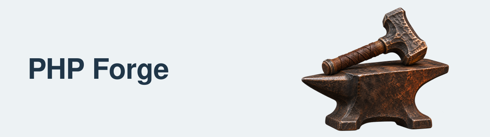

<!-- markdownlint-disable MD033 -->
<h1>
  <picture>
    <source media="(prefers-color-scheme: dark)" srcset="https://raw.githubusercontent.com/php-forge/.github/main/profile/assets/php-forge-cover-dark.png">
    <source media="(prefers-color-scheme: light)" srcset="https://raw.githubusercontent.com/php-forge/.github/main/profile/assets/php-forge-cover-light.png">
    
  </picture>
</h1>
<!-- markdownlint-enable MD033 -->

PHP tools for frontend assets, project scaffolding, and shared code-quality configuration.

Bring these workflows into Composer-based projects, with each tool documented in its own repository. Read each
repository's installation and compatibility notes before choosing a version.

## Documentation and contribution

Start with each repository's README, or explore the
[independent documentation portal](https://yii2-framework.github.io/docs/).

Read the [contribution guide](https://github.com/php-forge/.github/blob/main/CONTRIBUTING.md) before proposing a change.
For security concerns, follow the [security policy](https://github.com/php-forge/.github/blob/main/SECURITY.md).

## Support this work

If this work is useful to you, consider
[sponsoring @terabytesoftw on GitHub](https://github.com/sponsors/terabytesoftw).
